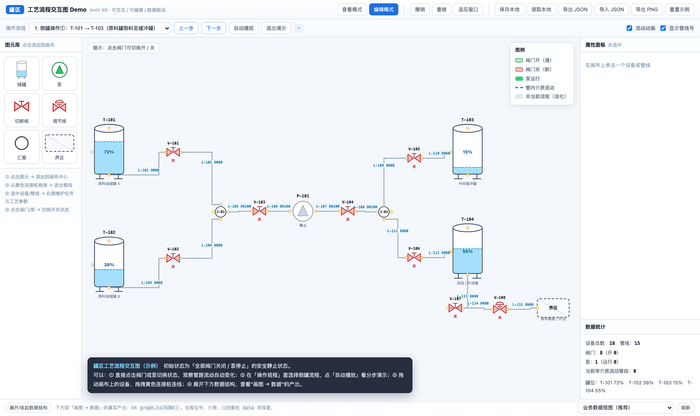
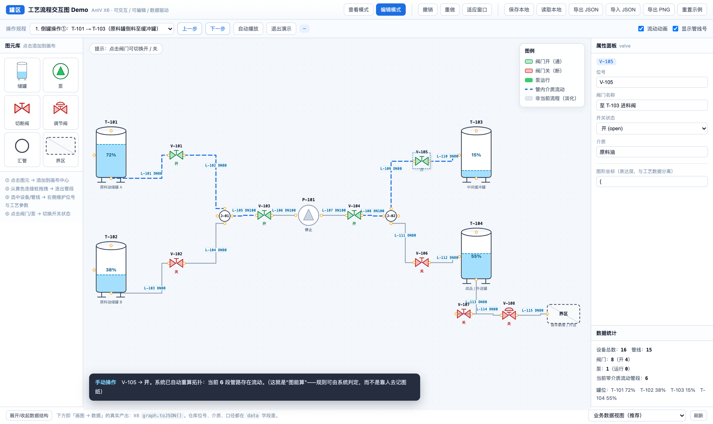
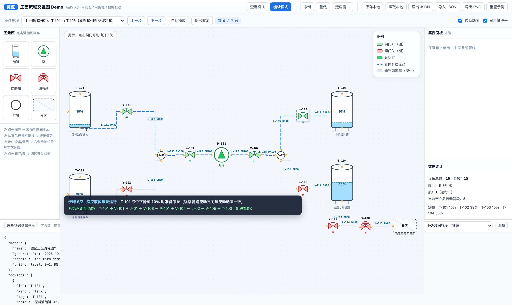

# 化工罐区工艺流程交互图 Demo

> AntV X6 · 可交互 / 可编辑 / 数据驱动 —— 用于评估「用图编辑引擎替代纸质图纸做新员工培训与倒罐操作演示」的可行性。


## 效果预览

| 初始状态（全部阀关 / 泵停） | 倒罐操作中（流体动画 + 阀门状态） |
|---|---|
|  |  |



> 三张图都由 `npm run shot` 自动生成，不是手工 P 的。

---

## 为什么用 AntV X6

同时评估过 GoJS（商业库，流程/HMI 示例很漂亮）与 AntV X6，最终选 X6：

| 维度 | AntV X6 ✅ | GoJS |
|---|---|---|
| 授权 | **MIT，商用免费** | 按开发者收费（约 $3,995 起，以官网为准） |
| 中文文档 | 原生中文 | 英文为主 |
| 化工 P&ID 先例 | 社区有完整案例可参照 | 有官方 `processFlow` 样例，但仅作参考 |
| P&ID 必需能力 | 自带 manhattan 路由 + **jumpover 跳线**（管线交叉的标准画法） | 同样支持 |
| 生态 | 插件齐全（history / selection / keyboard / snapline / export） | 生态成熟 |
| 可控性 | 图元即 SVG `path`，完全可控 | 自定义图元成本略高 |

另外本项目选用 **X6 2.19** 而非 3.x：与参考的开源化工图编辑器版本一致，社区示例最多，踩坑最少。

---

## 一、快速开始

前置：**Node.js ≥ 18**（仓库带 `.nvmrc`，可用 `nvm use` 切换）

```bash
npm install
npm run dev          # 打开终端提示的地址（默认 http://localhost:5188）
```

其它命令：

```bash
npm run build        # 生产构建（输出 dist/，相对路径，可直接丢到静态服务器）
                            # 产物目录 dist/ 可部署到 GitHub Pages / Nginx / 任意静态托管
npm run preview      # 本地预览构建产物（默认 5188 端口）
npm run typecheck    # TypeScript 类型检查
npm test             # 交互自测（11 项，需先启动 npm run dev）
npm run shot         # 自动截图到 shots/（需先启动 npm run dev）
```

> `npm test` / `npm run shot` 依赖本机有 Chrome 或 Chromium（会自动查找 Playwright 缓存与系统安装的浏览器；
> 找不到时用 `CHROME_PATH=/path/to/chrome` 指定）。这两个脚本只是开发期自测，不影响 Demo 本身的运行。

---

## 二、这个 Demo 演示了什么

| 能力 | 说明 | 在界面上怎么体验 |
|---|---|---|
| **交互查看** | 缩放、平移、框选、适应窗口 | 滚轮 / Ctrl+滚轮缩放、空白处拖拽平移、Shift+拖拽框选 |
| **可编辑** | 新增图元、拖动设备、改位号、连线成管段、撤销重做 | 左上图元库点击添加；拖动节点；从黄色连接桩拖拽连线；Ctrl+Z |
| **阀门开 / 关** | 点击阀门即切换状态，画面与数据同时变化 | 直接点击任意阀门（绿=开 / 红=关） |
| **泵启 / 停** | 点击泵切换运行状态 | 点击 P-101（绿=运行 / 灰=停止） |
| **液位表现** | 储罐液位随数据实时重绘 | 选中储罐 → 右侧拖动液位滑块 |
| **流动动画** | **由拓扑自动推导**哪些管段有介质流动，只对通的那段跑动画 | 打开任意阀门链条，观察蓝色虚线流动 |
| **操作规程演示** | 内置 4 套操作规程分步脚本（含一套错误示范） | 选择「操作规程」→ 下一步 / 自动播放 |
| **路径自动识别** | 自动算出「从 A 罐到 B 罐经过哪些阀、哪几段管」 | 演示时说明条会打印 `T-101 → V-101 → J-01 → … → T-103（8 段管路）` |
| **查看 / 编辑模式** | 查看模式锁定布局，防止新员工误改图纸 | 右上角切换 |
| **画布 → 数据** | 一键导出业务数据 / X6 原始 JSON | 底部展开数据结构；「导出 JSON」 |
| **图纸导出** | 导出 PNG，可直接放进培训手册 / PPT | 「导出 PNG」 |
| **本地存取** | 保存到浏览器，下次恢复 | 「保存本地 / 读取本地」 |

---

## 三、目录结构

```
tankfarm-x6-demo/
├─ index.html                  # 页面骨架：顶栏 / 图元库 / 画布 / 属性面板 / 数据面板
├─ src/
│  ├─ main.ts                  # 入口：画布创建、插件、图元面板、属性面板、演示播放器、工具栏
│  ├─ shapes.ts                # 图元定义（罐/泵/阀/汇管/界区/管线）+ 数据→画面渲染 + 面板缩略图
│  ├─ ops.ts                   # 拓扑推导：哪些管段在流动、A→B 路径、状态改数据、统计
│  ├─ demo-data.ts             # 领域数据模型 + 罐区示例数据 + 4 套操作规程脚本
│  ├─ domain-export.ts         # 「画布 → 业务数据」导出（设备台账 / 管段表 / 邻接表 / 连通判定）
│  └─ styles.css               # 界面样式
├─ scripts/
│  ├─ browser.mjs              # 自测脚本共用的浏览器启动器（跨平台查找 Chrome）
│  ├─ test-interactions.mjs    # 交互自测（11 项，失败时退出码 1，可用于 CI）
│  └─ shot.mjs                 # 自动截图（初始 / 流动 / 演示中）
├─ shots/                      # README 用的效果截图
├─ .github/workflows/ci.yml    # CI：类型检查 + 构建
└─ LICENSE / .gitignore / .editorconfig / .nvmrc
```

### 分层设计（关键）

```
① 表达层  X6 的 attrs / router / connector  →  决定"长什么样、怎么走线"
② 语义层  节点 data 与端口 data             →  位号、介质、口径、端口方向
③ 业务层  阀门状态 / 液位 / 操作规程脚本     →  培训与操作演示的核心价值
④ 数据层  graph.toJSON() / buildDomainExport →  可入库、可对接其他系统
```

表达层可以随时替换（换图库、换符号），**语义层和业务层是你们真正的资产**。

---

## 四、数据模型（当前最小集）

```ts
// 设备 / 管线上的业务数据（存在 X6 cell 的 data 字段里）
interface DeviceData {
  kind: 'tank' | 'pump' | 'valve' | 'cvalve' | 'tee' | 'boundary' | 'pipe';
  tag: string;                    // 位号：T-101 / V-103 / L-105
  name?: string;                  // 设备名称
  state?: 'open' | 'closed'        // 阀门
        | 'running' | 'stopped';  // 泵
  level?: number;                 // 液位 0~1
  medium?: string;                // 介质
  service?: string;               // 工艺说明（培训用）
  dn?: string; pn?: string;       // 管段：公称直径 / 压力等级
}

// 端口（连接桩）上的数据 —— 决定"能不能连"
interface PortData { dir: 'in' | 'out' | 'bi'; label: string; medium: string }
```

导出为业务数据后长这样：

```json
{
  "meta": { "name": "罐区工艺流程图", "schema": "tankfarm-demo/1.0" },
  "devices": [ { "id": "T-101", "kind": "tank", "tag": "T-101", "level": 0.72,
                 "layout": { "x": 60, "y": 60 },
                 "ports": [ { "id": "out", "dir": "out", "medium": "Liquid" } ] } ],
  "pipes":   [ { "id": "L-101", "tag": "L-101", "dn": "DN80", "pn": "PN16",
                 "from": { "device": "T-101", "port": "out" },
                 "to":   { "device": "V-101", "port": "in" } } ],
  "adjacency": { "T-101": ["L-101"], "V-101": ["L-101", "L-102"] },
  "connectivity": { "openValves": ["V-101"], "runningPumps": ["P-101"],
                    "flowingPipes": ["L-101", "L-102"] }
}
```

注意 `layout`（图形坐标）与工艺数据是**分开的两块**：换图库时工艺数据不用动。

---

## 五、怎么继续往下做

### 1) 换成你们自己的图元
`src/shapes.ts` 里每个图元的轮廓都是一个 SVG `path` 的 `d` 字符串。把你们 CAD / 图纸里的符号导成 SVG path 替换进去即可，尺寸改 `SIZE`。

### 2) 扩充数据字典
按你们 P&ID 规范往 `DeviceData` 加字段（管径、材质、保温、安全阀定压、连锁编号、SIL 等级……），
在 `src/main.ts` 的 `fieldDefs()` 里加一行就出现在属性面板上。建议**先定 12~15 个字段做扎实**。

### 3) 新增操作规程
在 `src/demo-data.ts` 的 `OPERATIONS` 里加一份 Json 即可（无需改代码）：

```ts
{
  id: 'op5', name: '倒罐操作③：T-102 → T-103', from: 'T-102', to: 'T-103',
  steps: [
    { text: '作业前确认…', focus: ['T-102', 'T-103'] },
    { text: '打开 V-102…', set: { 'V-102': 'open' }, focus: ['V-102'] },
    { text: '启动泵…',     set: { 'P-101': 'running' },
      focus: ['P-101'], flow: { from: 'T-102', to: 'T-103' } },
  ],
}
```

### 4) 加操作规则校验（很有价值的一步）
现在 `ops.ts` 已经能做连通性判定，再往前一步就是**规则引擎**：例如
「同一总管不得同时向两台罐进料」「改阀门前必须先停泵」「液位超上限禁止进料」。
规则命中就在说明条上报警——把老师傅脑子里的经验固化成代码。

### 5) 接后端 / 实时数据
- 保存：把 `graph.toJSON()` 存到后端（一张表一个 JSONB 字段就够）
- 实时：如果以后要接 DCS/PLC 数据，把 `data.state`、`data.level` 换成来自 WebSocket/MQTT 的推送，
  画布会自动跟着变（本项目里"演示脚本改数据 → 画面变化"走的正是这条链路）

---

## 六、已知限制 / 待完善

- 图元为示意画法，**未严格按 GB/T 6567、ISO 10628 或你们院标绘制**，正式使用需替换为规范符号
- 管段只有管线号 / DN / PN / 介质四个字段，未做管件（弯头、异径、盲板）与支管点
- 演示脚本的步骤数据是手写的；正式版建议由工艺专业维护成可编辑的表格
- 未实现多页图纸、页间连接（界区节点目前只是画布内的示意）
- 未实现权限系统（当前用"查看/编辑模式"这一层最简单的方式替代）
- 大图性能：X6 3.x 支持 `virtual: true` 虚拟渲染，本项目用 2.x；若单图超过 ~1000 个节点建议升级评估
- 未做保存冲突处理（多人同时编辑同一份图纸）

---

## 七、技术栈与实现要点

| 层 | 用了什么 |
|---|---|
| 图编辑引擎 | `@antv/x6` 2.19.2 |
| 插件 | selection / history / keyboard / snapline / export |
| 构建 | Vite 5 + TypeScript 5（`strict: true`） |
| 渲染 | X6 自定义图元（SVG `path`）+ 自定义 HTML 叠加层 |
| 自测 | playwright-core（11 项交互回归 + 自动截图） |

几个踩坑后固定下来的做法，供二次开发参考：

- **流动动画是推导出来的，不是画出来的**：`computeWetEdges()` 从所有储罐出发做无向 BFS，
  只有"阀门开 / 泵运行"的设备才允许通过，得到"有水"的管段集合，再用 `requestAnimationFrame`
  改 `strokeDashoffset` 实现流动 —— 所以开关任意阀门，动画立刻跟着变，不需要维护动画配置。
- **演示脚本可重复回放**：每次「下一步」都先 `resetStateData()` 回到基线、再依次 `applyStep(0..i)`，
  所以「上一步」也永远正确，不会状态残留。
- **`refX/refY` 的坑**：X6 只把 `0 < value < 1` 当百分比，`refY: 1` 会被当成 1 像素。
  本项目统一写 `'50%'` / `'100%'` 这类字符串。
- **`cell.isEdge` 是方法**，必须 `cell.isEdge()` 调用，不能直接做真值判断。
- 查看/编辑模式用 **函数式 `interacting`**：`graph.options.interacting` 支持传函数，可就地读当前模式，
  不用销毁重建画布。

## 八、License

[MIT](LICENSE) © 2026 consoleloghello

第三方依赖均为 MIT 许可（AntV X6 及其插件、Vite、TypeScript）。
仓库内的示例工艺数据（罐区拓扑、4 套倒罐操作规程）为**虚构演示数据**，不涉及任何真实装置。

> 注意：本项目图元为**示意画法**，未严格按 GB/T 6567 / ISO 10628 绘制。
> 若要正式用于工程设计或操作票，请替换为符合你们院标/企标的规范符号，并履行相应审批。
